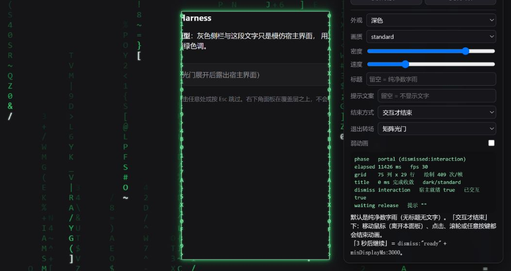

# dsh-codefall【数字雨】开机动画 + 绿色语义主题。

 
[](https://github.com/4444Hao/dsh-codefall/actions/workflows/test.yml)


当前仓库新增：**矩阵光门转场**与**每次打开窗口重播**。以下说明针对本地工作版本；尚未发布新的 npm 包。上面的动图展示的是原有数字雨。

## 快速开始

在桌面端 **设置 → 插件 → 添加插件** 里填：

```
dsh-codefall
```

安装时**别关进度弹窗**，完成后点「立即启用」，然后**重启应用**。

命令行等价（走 npm 镜像，约 2 秒，无需代理）：

```bash
dsh plugin --profile desktop add dsh-codefall
```

其他来源：

```bash
# 从 GitHub 仓库（约 8 秒，需要能访问 GitHub）
dsh plugin --profile desktop add github:4444Hao/dsh-codefall

# 从 GitHub Release 的预构建包
dsh plugin --profile desktop add https://github.com/4444Hao/dsh-codefall/releases/download/v0.1.0/dsh-codefall-0.1.0.tgz

# 从本地已下载的 tgz
dsh plugin --profile desktop add D:\下载\dsh-codefall-0.1.0.tgz
```

默认仅在应用启动时播放，数字雨会持续到你移动鼠标、点击、滚轮或按键；界面就绪后，屏幕中央出现细长绿色矩形光门，向左右展开，约 **750 ms** 后进入 Harness。门内直接显示当前界面，门外仍然是数字雨。



浅色模式是"墨迹雨"（白底深绿）：


## 设置 → **开机动画codefall**：

| 项 | 取值 | 默认 | 生效 |
|---|---|---|---|
| **播放时机** | 仅应用启动时 / 每次打开窗口 | **仅应用启动时** | **保存后** |
| 结束方式 | 交互后结束 / 3 秒后自动继续 | **交互后结束** | 下次动画 |
| **退出转场** | 矩阵光门 / 淡出 | **矩阵光门** | 下次动画 |
| 雨密度 | 30%–100% | 85% | 下次动画 |
| 雨速 | ×0.40–×2.50 | ×1.00 | 下次动画 |
| 画质 | 高 / 标准 / 省电 | 标准 | 下次动画 |
| 明暗 | 跟随系统 / 深色 / 浅色 | 跟随系统 | 下次动画 |
| **绿色主题** | 开 / 关 | **开** | **立即** |
| **绿色色调** | 110–175° + 三个预设 | **雨绿 145°** | **立即**（拖动即变） |

**每次打开窗口**：Windows 桌面窗口从托盘或最小化恢复时重新播放；普通切换焦点不重播。**仅应用启动时**：窗口留在后台再恢复不重播；完全退出后启动或重新加载应用页面会播放。Web 版切换标签页不重播。

系统启用“减少动态效果”时自动使用淡出；宿主错误或就绪超时也会走快速退出。进入动画的按键会被遮罩消费，避免误输入或发送消息。

卸载：`dsh plugin --profile desktop remove dsh-codefall`。主题层会随插件一起移除。


## 注意

1. **加载这次代码更新需完整重启应用**。此后在设置中修改播放时机无需再重启；动画参数会用于下次播放。
2. 原版在 Windows 桌面端验证过；本次光门已通过浏览器视觉检查及离线自动测试，**托盘/最小化恢复仍需真实 Harness 实测**。macOS 的遮挡也可能产生可见性事件，恢复播放的行为尚未实机验证。
3. 需要 Harness **0.2.0-rc.2 或更高**。插件本身零依赖，`react` 由宿主提供。
4. 想装在 Web 界面就把 `--profile desktop` 换成 `--profile web`。

实现细节与验收步骤见 [矩阵光门与窗口恢复播放](docs/PORTAL.md)。离线预览打开 `preview/index.html`，先点「就绪」，再点「交互」观察开门；「退出转场」可切回淡出。

## 许可证

[MIT](LICENSE)
