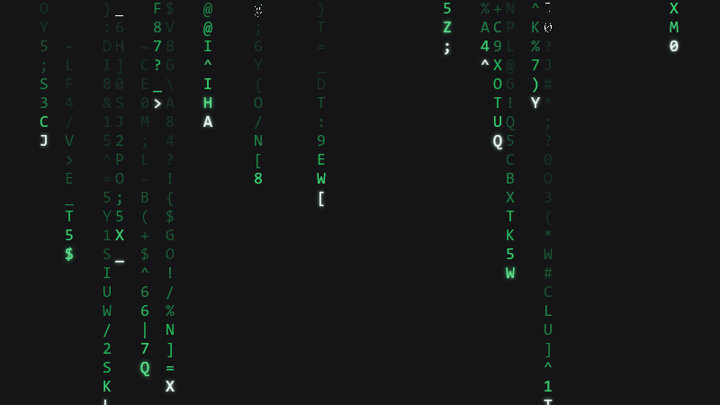
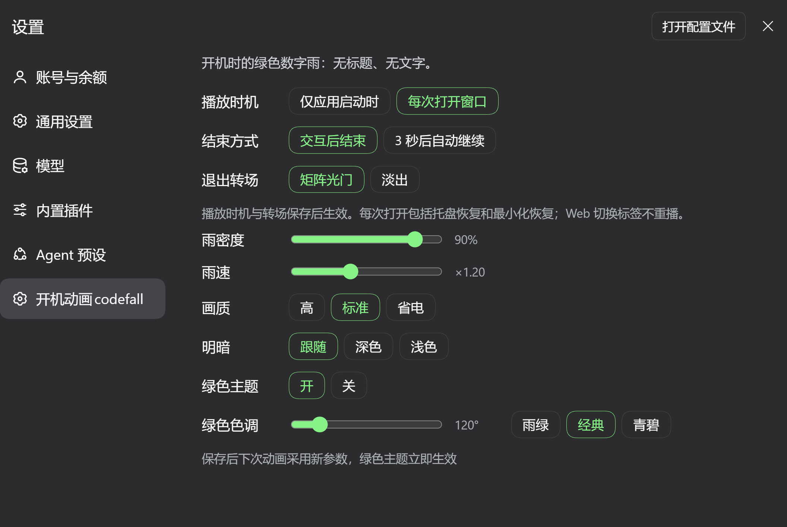
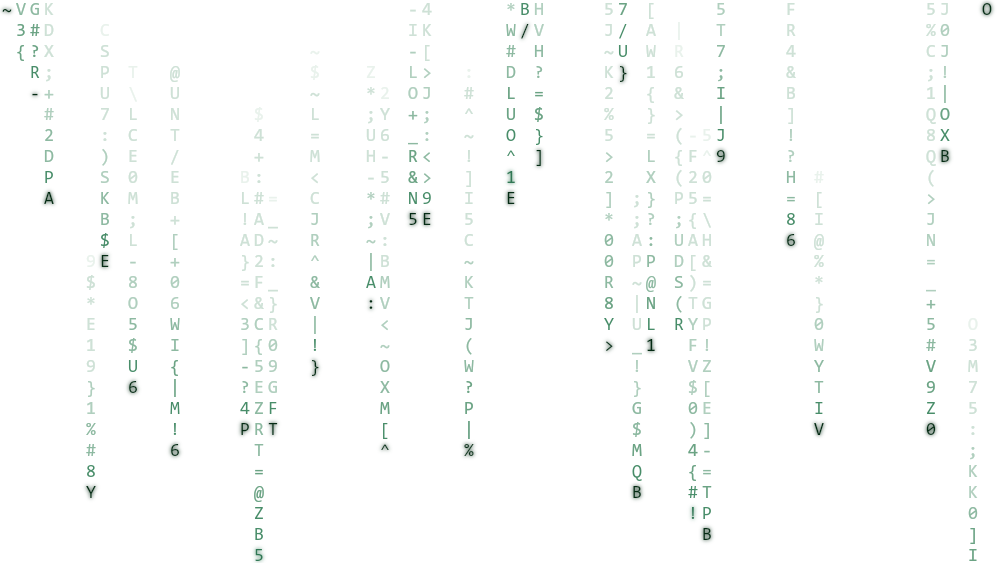
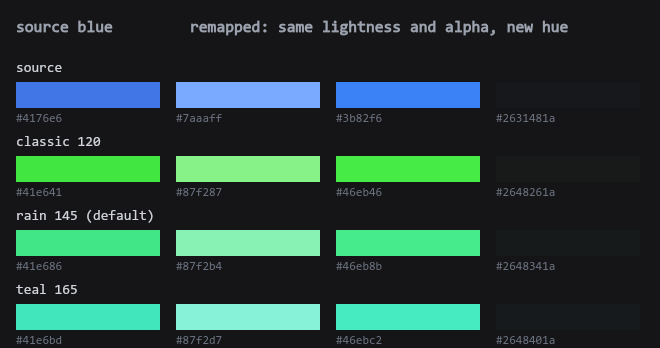

# dsh-codefall

**简体中文** | [English](README.en.md)

为 DeepSeek Harness 添加黑客帝国风格的数字雨开屏、向两侧展开的矩形光门，以及可调色相的绿色界面主题。

Matrix-inspired digital rain, a light portal that opens to both sides, and an adjustable green UI theme for DeepSeek Harness.

[](https://github.com/4444Hao/dsh-codefall/actions/workflows/test.yml)
[](LICENSE)

**已收录于 [dsh-market](https://github.com/dsh-market/dsh-market)**，可在插件市场中搜索 `dsh-codefall` 安装。[查看收录页面](https://awesome-dsh-plugin.com/p/4444Hao/dsh-codefall/)

[安装与使用](#安装与使用) · [设置](#设置) · [GitHub](https://github.com/4444Hao/dsh-codefall) · [npm](https://www.npmjs.com/package/dsh-codefall)



*数字雨由插件自带渲染器生成；此动图展示雨场，不包含光门转场。*

## 使用效果

- **数字雨开屏**：默认无标题、无提示文字，启动时进入绿色字符瀑布。
- **矩阵光门**：界面就绪并收到进入交互后，中央细长矩形光门向左右展开，逐渐露出 Harness 界面；也可选择淡出。
- **按需重播**：可选择仅应用启动时播放，或桌面窗口从后台、最小化状态恢复时重播。Web 标签切换不重播。
- **绿色主题**：将界面的蓝色强调色映射到绿色，支持雨绿、经典、青碧预设与色相调节；主题可单独关闭。
- **画面调节**：雨密度、雨速、画质与明暗模式均可设置。浅色模式呈现白底深绿的“墨迹雨”。

动画使用 Canvas2D 绘制，无需加载视频或在线动画素材；退出后清理雨场和动画帧。系统开启“减少动态效果”时，光门改用淡出。

## 安装与使用

在桌面端的插件管理页面搜索 **`dsh-codefall`**，或在“添加插件”中输入包名：

```text
dsh-codefall
```

等待安装完成并启用，然后**完整退出并重新启动应用**。

首次使用默认流程：**启动应用 → 数字雨 → 移动鼠标、点击、滚轮或按键 → 光门展开 → 进入界面**。进入转场需要宿主界面已就绪。

> “仅应用启动时”不是安装后只播放一次：完全退出后重新启动会再次播放，留在后台再恢复则不播放。要在恢复窗口时重播，请改选“每次打开窗口”。

<details>
<summary>命令行与其他安装来源</summary>

Web profile 可使用：

```bash
dsh plugin --profile web add dsh-codefall
```

如果你的桌面环境由 CLI 管理，且 profile 名称确为 `desktop`，可使用：

```bash
dsh plugin --profile desktop add dsh-codefall
```

桌面应用自带插件管理时，优先从应用内安装。以下为 CLI 管理环境的其他来源示例；profile、路径与文件名按实际环境调整：

```bash
# 从 GitHub 安装
dsh plugin --profile web add github:4444Hao/dsh-codefall

# 从本地已下载的包安装
dsh plugin --profile web add "D:\下载\dsh-codefall-0.2.0.tgz"
```

</details>

## 设置

打开插件的 **“开机动画 codefall”** 设置页。入口位置随 Harness 或桌面端版本而异。



*上图为 Windows 桌面端的真实设置截图，采用“每次打开窗口 / 交互后结束 / 矩阵光门”、雨密度 90%、雨速 ×1.20、经典绿 120°，不代表默认参数。*

| 设置 | 可选项 | 默认值 |
| --- | --- | --- |
| 播放时机 | 仅应用启动时 / 每次打开窗口 | 仅应用启动时 |
| 结束方式 | 交互后结束 / 3 秒后自动继续 | 交互后结束 |
| 退出转场 | 矩阵光门 / 淡出 | 矩阵光门 |
| 雨密度 | 滑块调节 | 85% |
| 雨速 | 滑块调节 | ×1.00 |
| 画质 | 高 / 标准 / 省电 | 标准 |
| 明暗 | 跟随 / 深色 / 浅色 | 跟随 |
| 绿色主题 | 开 / 关 | 开 |
| 绿色色调 | 滑块调节；雨绿 / 经典 / 青碧 | 雨绿 145° |

播放时机与转场保存后用于后续播放，调整后无需再次重启；绿色主题与色相立即生效。“3 秒后自动继续”仍需等待宿主界面就绪。

### 浅色数字雨



*与深色雨场采用同一渲染器，跟随宿主明暗或在设置中单独选择。*

<details>
<summary>绿色色相示意</summary>



此图是色彩映射示意，不是完整应用截图。色相设置作用于界面主题，并不表示数字雨字符同步变色。

</details>

## 兼容与说明

- 建议使用 Harness **0.2.0-rc.2 或更高版本**。安装或更新插件后，请完整退出并重启应用。
- 窗口恢复重播依赖桌面环境的可见性事件；当前实现针对 `dsh-app:` 桌面页面，其他桌面壳需单独验证。
- Windows 设置截图如上。光门已通过浏览器预览及离线测试；真实托盘 / 最小化恢复仍需按[实机验收步骤](docs/PORTAL.md#实机验收)验证。macOS / Linux 尚未实机验证，macOS 完全遮挡窗口也可能产生可见性事件。
- 不同宿主版本及第三方插件可能使用自己的配色；绿色主题的覆盖范围取决于它们是否采用宿主主题变量。
- 在应用的插件管理中停用或卸载即可移除主题层。CLI 管理环境可运行 `dsh plugin --profile web remove dsh-codefall`，profile 按实际环境调整。

## 开发与预览

光门实现、窗口恢复逻辑与验收记录见[矩阵光门与窗口恢复播放](docs/PORTAL.md)。打开本地 `preview/index.html`，先点“就绪”，再点“交互”观察光门；该页面为离线演示，不是实际 Harness 窗口。

市场展示图由根目录的 [screenshots.json](screenshots.json) 指定，顺序为**深色数字雨动图 → Windows 设置截图 → 浅色数字雨**。更新图片或顺序后，推送到自己的 GitHub 默认分支即可；目录下一次截图采集与部署完成后生效，不会即时刷新；无需重新投稿或仅为截图更新发布 npm 包。

## 许可证

[MIT](LICENSE)
